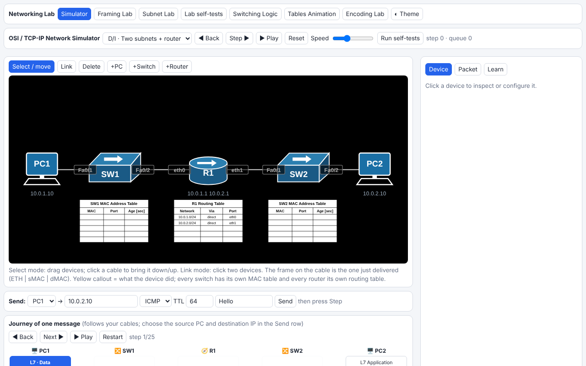
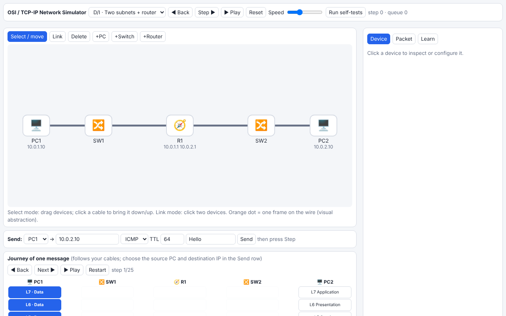
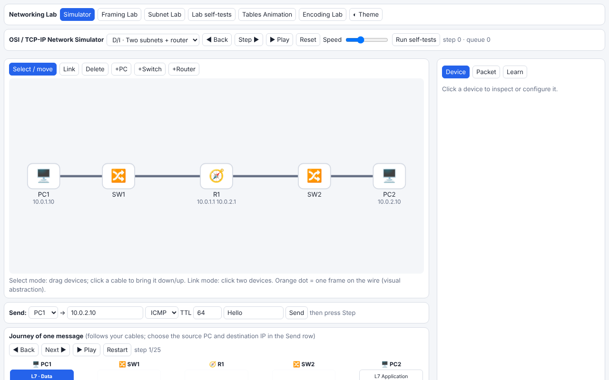

<div align="center">

# 🌐 OSI / TCP-IP Network Simulator

An interactive simulator that shows how data moves through a small network, step by step: ARP broadcasts, switch MAC learning, router longest-prefix matching and TTL updates.

[](https://meshannawod.github.io/osi-tcp-ip-network-simulator/)

  



</div>

## Live demos

| Version | What's new | Open |
|---|---|---|
| **v3** (latest) | Live MAC and routing tables drawn on the topology, dark canvas | [Launch v3](https://meshannawod.github.io/osi-tcp-ip-network-simulator/osi-tcp-ip-network-simulator_v_3/) |
| **v2** | Framing, subnet, switching-logic, encoding and table-animation labs | [Launch v2](https://meshannawod.github.io/osi-tcp-ip-network-simulator/osi-tcp-ip-network-simulator_v_2/) |
| **v1** | The original packet-journey simulator | [Launch v1](https://meshannawod.github.io/osi-tcp-ip-network-simulator/osi-tcp-ip-network-simulator_v_1/) |

## What you can do

- Build a topology: drag PCs, switches and routers, and draw cables between them
- Send a message (ICMP and others) from one PC to another and play it **step by step**
- Watch each frame's journey through the OSI layers, with the MAC addresses, IPs and TTL at every hop
- See switches learn MAC addresses and routers pick the longest matching prefix
- Run the built-in self-tests

This is a teaching tool. It does not model DNS, DHCP, NAT, VLANs, TCP flow control or wireless networks.

## Screenshots

| v1 | v2 |
|---|---|
|  |  |

## Run locally

No build step. Download the repository and open any `osi-tcp-ip-network-simulator_v_*/index.html` in a browser, or open `index.html` for the version picker.

## Project structure

```text
index.html                              version picker (GitHub Pages home)
osi-tcp-ip-network-simulator_v_1/       first version
osi-tcp-ip-network-simulator_v_2/       adds the labs
osi-tcp-ip-network-simulator_v_3/       latest version
docs/                                   screenshots
```

## Author

Made by **Meshan Nawod**, Physics undergraduate at the University of Peradeniya · [Portfolio](https://meshannawod.github.io/) · [GitHub](https://github.com/MeshanNawod)

## License

MIT. See [LICENSE](LICENSE).
